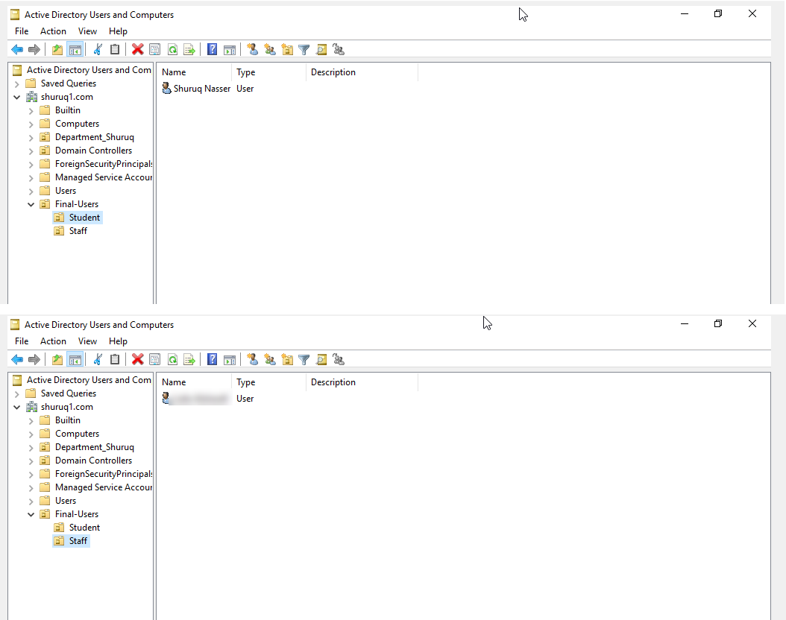
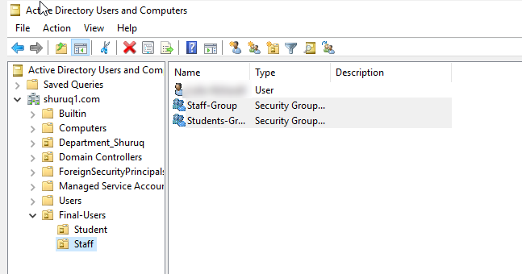
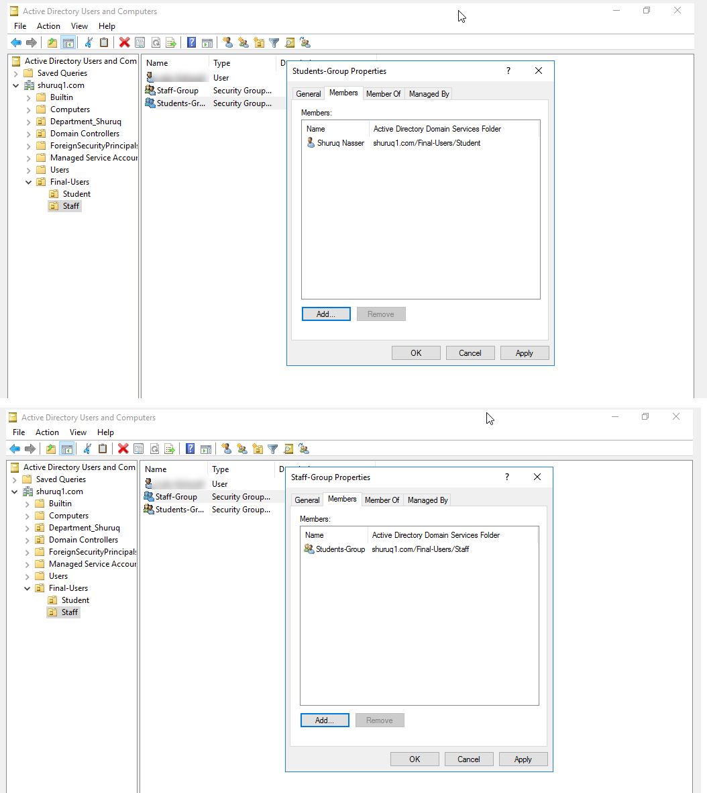
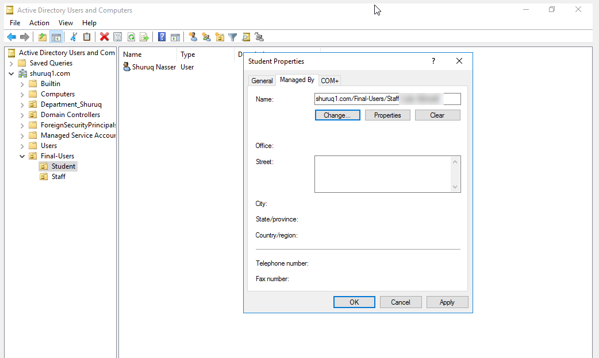
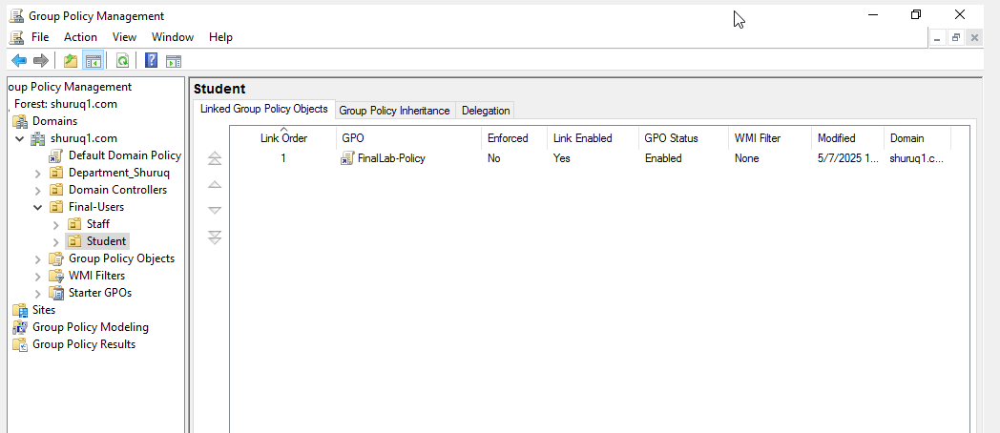
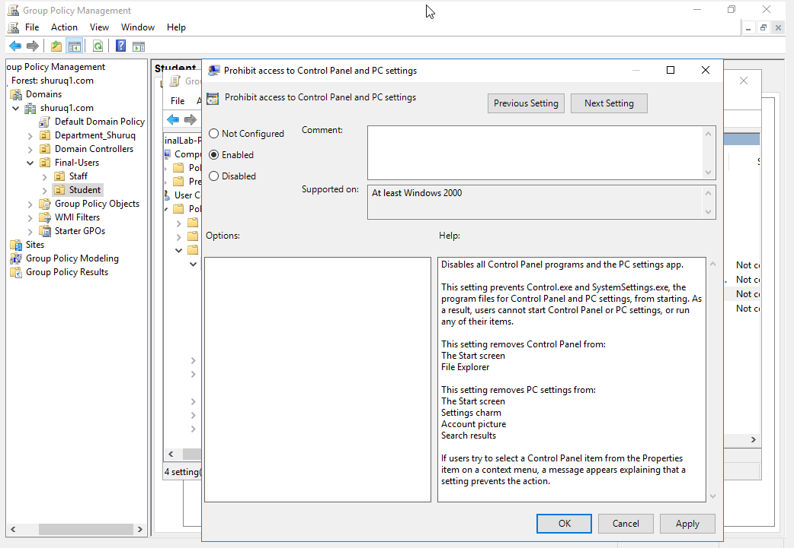

# Active Directory Lab: OUs, Groups, and Group Policy

Hands-on lab from my Networks Administration course. I built an Active Directory structure on Windows Server and used it to organize users, manage permissions through groups, and enforce a restriction with Group Policy.

## Environment
- Windows Server 2016 running in Oracle VirtualBox
- Active Directory Domain Services (AD DS), domain `shuruq1.com`
- Tools: Active Directory Users and Computers, Group Policy Management

## What I built
- An OU structure: `Final-Users` with two sub-OUs, `Student` and `Staff`
- Two users, `student1.finalexam` and `staff1.finalexam`, each placed in the correct OU
- Two security groups in the Staff OU, `Students-Group` and `Staff-Group`, with `Students-Group` nested inside `Staff-Group`
- A manager assigned to the Student OU using the "Managed By" field
- A Group Policy Object, `FinalLab-Policy`, linked to the Student OU to block access to Control Panel and PC settings

## Walkthrough

### 1. Organizational Units and users
I created the `Final-Users` OU and added the `Student` and `Staff` sub-OUs. Then I created one user in each OU and kept the default option that forces a password change at first logon for the student account.

### 2. Security groups
I created two global security groups in the Staff OU: `Students-Group` and `Staff-Group`.

### 3. Group membership and nesting
I added `student1.finalexam` to `Students-Group`, then added `Students-Group` as a member of `Staff-Group`. With nesting, anything granted to `Staff-Group` also applies to the students' group members, so permissions can be managed at the group level instead of per user.

### 4. Managed By
In the Student OU's properties, I used the "Managed By" tab to set `staff1.finalexam` as the OU's manager. This records who is responsible for the OU. (The name is blurred in the screenshot for privacy.)

### 5. Group Policy Object linked to the OU
I created a GPO named `FinalLab-Policy` in Group Policy Management and linked it to the Student OU, so it applies to the users inside that OU only.

### 6. Policy configuration
Inside the GPO, under User Configuration > Administrative Templates > Control Panel, I enabled **Prohibit access to Control Panel and PC settings**.

## What I learned
- How OU design decides where Group Policy applies, because a GPO only affects the OU it is linked to
- The difference between creating a GPO, linking it to an OU, and configuring the settings inside it
- How group nesting simplifies permission management
- 

